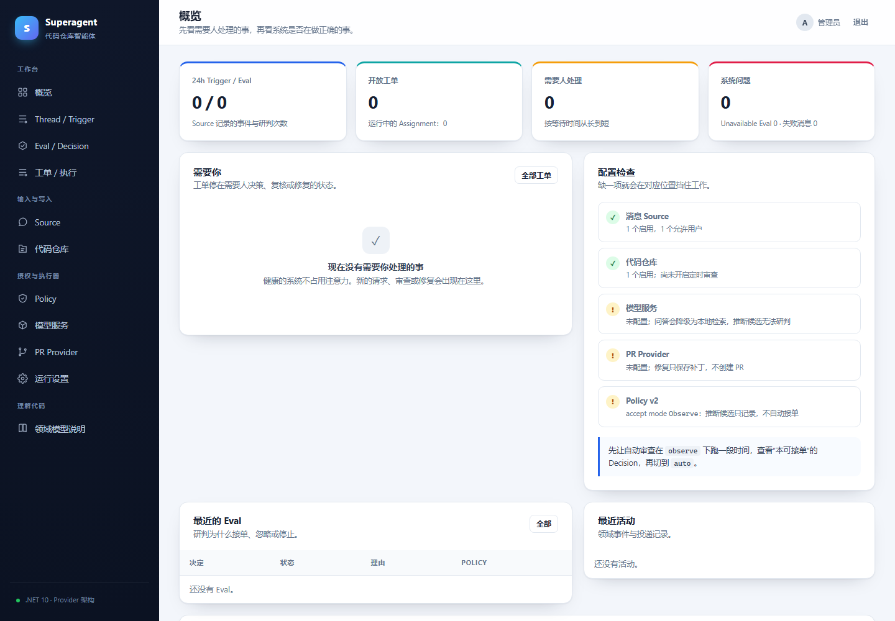
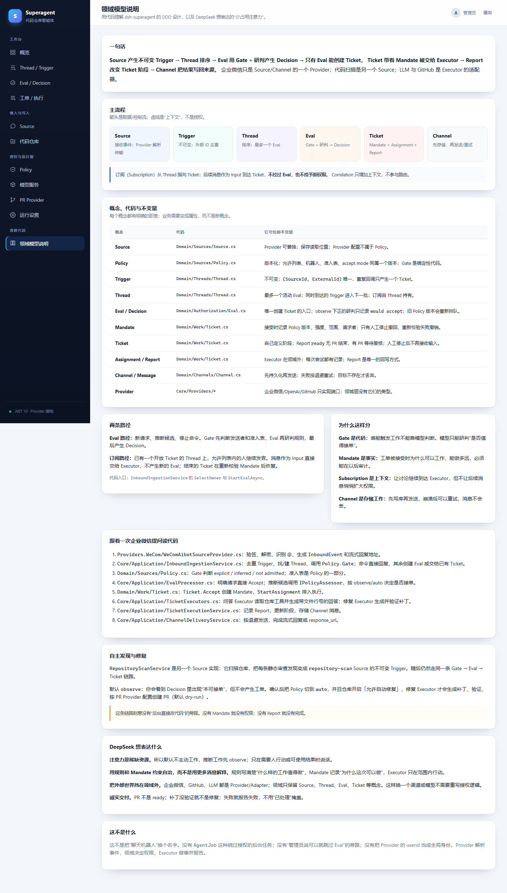

# dsh-superagent (.NET 10)

一个参考 [deepseek-ai/dsh-superagent-prototype](https://github.com/deepseek-ai/dsh-superagent-prototype) 的 .NET 10 实现：

- 支持 **企业微信、飞书、GitHub 与 Gitea** 消息/事件入口；新请求仍由 Source Policy 约束。
- 用 **Source → Trigger → Thread → Eval → Decision → Mandate → Ticket → Assignment → Report → Channel** 这条领域链路处理每一次请求。
- 让机器人基于配置好的代码仓库回答问题，例如“用户列表页的分页逻辑在哪里？”。
- 定时扫描代码仓库，把静态审查发现变成推断候选；在 `auto` 模式下创建修复工单，生成、验证补丁并通过 PR Provider 提交 PR。
- 提供完整的设置界面：Source、代码仓库、模型、PR、Policy、线程/研判/工单、运行设置与领域模型说明。
- 企业微信只是 `wecom-aibot` Provider；LLM、GitHub 与 Gitea 也是 Provider。领域层不依赖它们。

> 这是一个可运行的教学型实现，不是生产级成品。默认 PR dry-run、默认 Policy `observe`、默认只允许明确请求，都是刻意保守的选择。



## 1. 快速开始

前置条件：.NET 10 SDK、Git。

```bash
dotnet restore DshSuperagent.sln
dotnet build DshSuperagent.sln
dotnet run --project src/DshSuperagent.Web/DshSuperagent.Web.csproj --urls http://127.0.0.1:5180
```

打开 <http://127.0.0.1:5180>：

- 开发环境默认管理员密码：`admin123`
- 生产环境必须设置 `SUPERAGENT_ADMIN_PASSWORD`，否则启动失败
- 数据库和 Data Protection key 默认在 `src/DshSuperagent.Web/App_Data/`
- 健康检查：`GET /health`

首次使用顺序：

1. **代码仓库**：新增一个服务器上可读的 Git 目录，设置 slug、默认分支和验证命令。
2. **模型服务**：配置 OpenAI 兼容模型（DeepSeek/Qwen/Ollama 等），设为默认。未配置时问答会降级为本地代码检索。
3. **PR Provider**：选择 GitHub 或 Gitea，配置 Token 与 API 地址。默认 dry-run；确认后再关闭。Gitea 配置步骤见下文。
4. **Source**：企业微信配置加密 HTTP 回调；飞书使用机器人 `lark-cli` 事件流；GitHub 使用指定账号 `gh`，Gitea 使用 REST 轮询。后三者无需公网回调，详见 [后台来源接入](docs/background-sources.md)。
5. **Source Policy**：填入允许的企微 `userid`、飞书 `open_id` 或代码托管账号 `login`；按需调整准入表。
6. **Policy**：规则默认 `code-quality` 开启；先保持 `observe`，观察“本可接单”记录，再考虑切 `auto`。

## 2. 企业微信配置

在企业微信管理后台创建“智能机器人”，填写：

- **回调 URL**：`https://你的公网域名/api/sources/{source-id}/callback`
- **Token**：与 Source 配置中的 Token 一致
- **EncodingAESKey**：与 Source 配置一致

回调 URL 必须是公网可达的 HTTPS 地址。企业微信会先发 GET 验证请求：

1. 校验 `msg_signature`
2. AES-256-CBC 解密 `echostr`
3. 原样返回明文（无引号、无 BOM、无换行）

消息处理：

- 群聊只有 `@机器人名称` 的消息才会进入领域；单聊直接进入。
- `@` 名称可在 Source 中配置，并支持额外别名。
- 默认使用**流式消息**：先回复“已收到”，完成时返回最终答案。
- 也可切到 **response_url** 模式：只发送最终答案；`response_url` 只允许发往配置的 HTTPS 白名单主机。

详见 [docs/wecom-setup.md](docs/wecom-setup.md)。

## 3. 使用方式

在企微单聊或群里 `@机器人`：

```text
用户列表页的分页逻辑在哪里实现？
订单页的取消按钮做了什么？
/repo order-service 退款流程经过了哪些类？
/repos
/status
/help
/review order-service
/fix order-service
/fix order-service <finding-id>
/stop
```

- 自然语言提问：走 Eval → Ticket(Answer) → Executor；回答必须基于仓库证据，并给出 `文件:行号`。
- `/repo <slug> <问题>`：指定仓库。
- `/repos`、`/status`、`/help`：直接回复，不创建工单。
- `/review [slug]`：触发一次仓库扫描；每条发现作为 Trigger 进入同一条 Eval/工单链路。
- `/fix [slug] [finding-id]`：明确请求修复；未给 finding id 时扫描并选择最高优先级问题。
- `/stop`：停止当前 Thread 上打开的工单；只有人工停止会撤回 Mandate。

允许列表为空时拒绝所有人；未列入允许列表的用户无法使用机器人。

## 4. 自主发现与修复

自主审查不是旁路，而是另一个 Source：

1. `RepositoryScanService` 扫描启用 `AutoReviewEnabled` 的仓库。
2. 每条静态审查发现变成 `repository-scan` Source 的不可变 Trigger，外部 ID 由 commit + 规则 + 文件 + 行号决定，重复扫描不会重复建单。
3. Gate 把系统候选标为 `inferred`；Policy 的 accept mode 决定是否接单。
4. 默认 `observe`：记录 Decision 与“本可接单”，不创建工单。
5. 切到 `auto` 且仓库开启“允许自动修复”后，Eval 创建 Fix Ticket 和 Mandate。
6. `RepositoryFixExecutor` 调用模型生成 unified diff，在隔离 `git worktree` 中：
   - `git apply --check`
   - 应用补丁
   - 执行仓库配置的验证命令
   - 读取变更文件
7. PR Provider 通过 GitHub Git Data API 或 Gitea 批量 Contents API 创建分支、commit、PR；默认 dry-run 时只保存补丁，可在工单详情下载 `.patch`。
8. 结果写入 Report；有 PR 时工单进入“等待复核”，否则按 `ready` 协议结束。

**没有任何“后台直接改代码”的旁路。** 没有 Mandate 就没有权限；没有 Report 就没有完成。

## 5. DDD 结构

```text
src/
  DshSuperagent.Domain/          领域层：聚合、实体、值对象、不变量、领域事件
  DshSuperagent.Core/            应用层：用例、端口、Agent、仓库工具、策略研判
  DshSuperagent.Providers.WeCom/        企业微信 Source/Channel Provider
  DshSuperagent.Providers.OpenAiCompatible/ LLM Provider
  DshSuperagent.Providers.Common/       CLI 安全执行与代码托管来源语义
  DshSuperagent.Providers.Feishu/       飞书 CLI Source/Channel Provider
  DshSuperagent.Providers.GitHub/       GitHub CLI Source/Channel + PR Provider
  DshSuperagent.Providers.Gitea/        Gitea REST Source/Channel + PR Provider
  DshSuperagent.Web/             宿主 + 基础设施 + Razor Pages 面板
tests/
  DshSuperagent.Tests/           领域、Provider、HTTP 回调、完整链路测试
```

主要概念：

| 概念 | 作用 | 代码 |
| --- | --- | --- |
| Source | 事件来源；Provider 适配器 | `Domain/Sources/Source.cs` |
| Policy | 版本化规则、允许列表、准入表、accept mode | `Domain/Sources/Policy.cs` |
| Trigger | 不可变事件，按 Source 外部 ID 去重 | `Domain/Threads/Thread.cs` |
| Thread | 事件排序；最多一个 Eval；订阅集合 | `Domain/Threads/Thread.cs` |
| Eval / Decision | 唯一创建 Ticket 的入口；Gate + 研判 | `Domain/Authorization/Eval.cs` |
| Mandate | 授权事实：Policy 版本、强度、范围、请求者 | `Domain/Work/Ticket.cs` |
| Ticket | 授权工作单元；自己定义阶段 | `Domain/Work/Ticket.cs` |
| Assignment / Report | Executor 的尝试与回写 | `Domain/Work/Ticket.cs` |
| Channel | 写回来源；先存储再发送 | `Domain/Channels/Channel.cs` |
| Provider | 企业微信/LLM/GitHub/Gitea 的端口实现 | `Core/Providers/*`、`Providers/*` |

更完整的讲解、聚合边界、不变量和代码阅读顺序见 [docs/DDD.md](docs/DDD.md)，面板中也有“领域模型说明”页。



## 6. 设置界面

- **概览**：待人工处理、系统问题、24h 活动。
- **Source**：Provider 配置、回调或后台接入方式、接收健康状态、允许用户/机器人、准入表。
- **代码仓库**：本地路径、分支、包含/排除 Glob、验证命令、自动审查/自动修复开关。
- **模型服务**：OpenAI 兼容 endpoint/key/model，测试连接。
- **PR Provider**：GitHub / Gitea Token、API 地址、draft / WIP、labels、dry-run。
- **Policy**：accept mode、proactive 规则、各 Source 的 Policy 部分。
- **Thread / Trigger**：时间线、每个 Trigger 的最新 Disposition、Eval 队列、订阅。同一 Trigger 可有多条历史处置，详情按 CreatedAt 取最新，时间相同时按 Id 降序稳定选择；历史记录不删除。
- **Eval / Decision**：接单/忽略/停止/不可用，以及 “would accept”。
- **工单 / 执行**：Mandate、Inputs、Assignments、Reports、Channel 投递、补丁下载。
- **运行设置**：Agent 轮次、扫描间隔、并发、验证超时、团队提示词、部署信息。

### Gitea PR Provider

1. 在 **PR Provider** 新增配置，选择 `gitea`。需要支持批量文件变更的 Gitea API（按 [Gitea 1.24 API](https://docs.gitea.com/api/1.24/operations/repo-change-files/) 实现）。
2. 填写完整 API 根地址，例如 `https://git.example.com/api/v1`；部署在子路径时填写 `https://example.com/gitea/api/v1`。仅本机回环地址允许 HTTP；不自动跟随重定向。
3. Token 需有目标仓库代码及 PR 的读写权限；连接检查调用 `GET /user`，还需用户信息读取权限。Token 使用已有 Secret 字段加密存储。
4. 在 **代码仓库** 选择该 PR 配置，并显式填写 **PR Owner / Repository**（用户或组织名 / 仓库名）。Remote URL 自动推断目前仅支持 github.com。
5. 保持 dry-run 检查补丁，再关闭以启用真实写入。默认 dry-run 不调用 API；无 Token 的连接检查只报告 dry-run，不能证明认证成功。

文件新增/修改/删除通过一次 `POST /repos/{owner}/{repo}/contents` 提交到新分支；修改/删除先读取基线文件 SHA，不修改本地工作区。重试按目标仓库、head 和 base 复用已有 PR（包括已关闭/合并的 PR）；已有分支不覆盖其内容，只补建缺失 PR。因此分支名应由本应用独占，不应复用手工分支。

`labels` 填已有仓库标签名，以逗号分隔；Provider 会分页查找并转成数字 ID，缺失标签时在写入前报错。`draft` 使用 [`WIP:` 标题前缀](https://docs.gitea.com/usage/pull-request)，不是 GitHub 的 draft 字段；服务器需保留默认 WIP 前缀配置。PR 创建失败后可重试，已有分支不会再次提交。

## 7. 安全设计

- 管理面板使用 Cookie 认证；生产必须配置 `SUPERAGENT_ADMIN_PASSWORD`。
- 登录失败限流（同一 IP 5 次/5 分钟）。
- Source 配置、LLM API Key、PR Token（GitHub / Gitea）通过 ASP.NET Data Protection 加密存储；测试验证数据库中看不到明文 token。
- `response_url` 只允许 HTTPS、默认端口、Source 配置的 `responseHost`（默认 `qyapi.weixin.qq.com`）和 `/cgi-bin/aibot/response` 路径，防止 SSRF。
- 仓库工具只允许配置的本地目录；拒绝绝对路径、`..`、符号链接逃逸；跳过 `.git`、`bin`、`obj`、`node_modules`、`.env`。
- Git 工作树的文件列表、搜索和静态扫描通过原生 `git check-ignore --no-index` 应用根目录及嵌套 `.gitignore`（含反向包含、转义、目录规则），也遵循 Git 的全局及 `.git/info/exclude` 规则。即使文件已被 Git 跟踪，只要匹配忽略规则也不作为候选；显式包含 Glob 不覆盖忽略规则，默认安全排除目录和显式排除 Glob 不会被 `!` 重新包含。普通非 Git 目录仍使用默认过滤和配置 Glob。若 Git 不可用、超时或拒绝读取工作树，则明确报错，不静默回退到未过滤扫描。
- 静态扫描在应用文件数量上限前跳过超过 512 KB 的文件；列举后文件变大、删除或不可读时也跳过该文件，不中断其他文件扫描。扫描数量仅统计实际读取的文件。显式读取文件仍受 512 KB 限制。临时验证目录可在 `.gitignore` 或排除 Glob 中配置 `**/_verify/**`。
- 补丁只在临时 Git worktree 中应用和验证，不修改工作区。
- PR 默认 dry-run；不会自动合并。
- 模型提示词明确把仓库文本视为不可信数据，不得改变授权。

## 8. 测试

运行测试集（下列覆盖项不代表本次修改已执行测试）：

```bash
dotnet test tests/DshSuperagent.Tests/DshSuperagent.Tests.csproj
```

覆盖：

- WeCom AES 加解密、签名校验、错误 ReceiveId、篡改密文。
- URL 验证、加密文本回调、流式回复、重复回调幂等。
- 群聊必须 `@`、允许列表拒绝、未授权用户不建单。
- Gate 的 explicit/inferred/not admitted、准入表、accept mode。
- Ticket 阶段：ready 无 PR 完成、有 PR 等待复核、人工停止撤回 Mandate、结束后人工跟进恢复。
- Mandate 重新校验。
- Source 配置密文落库。
- 自动扫描 → inferred Eval → Fix Ticket → 补丁验证 → PR；自动修复预算限制与超预算发现记录。
- 重启后 Running Eval/Assignment 的恢复、三次后 Eval unavailable。
- SQLite 下仅恢复超过五分钟的 Sending 消息，保留近期发送及其他状态；时间阈值在 .NET 中预计算后作为 SQL 参数。
- Channel 消息三次失败后的终态、失败/丢弃消息的可见性。
- `observe` 只记录 would accept，不建单。
- WeCom response_url 白名单与 SSRF 拒绝。
- GitHub Git Data API 的分支/commit/PR 流程与 dry-run。
- Gitea 批量文件变更、标签 ID、WIP、分页 PR 复用、连接检查及输入拒绝（Mock HTTP，不调用真实 Gitea）。
- 后台来源的飞书消息标准化、CLI 身份核对、稳定投递 ID、GitHub/Gitea 讨论与 API 差异（Mock CLI/HTTP；新增源码不代表已执行）。
- 仓库路径/排除规则/路径穿越、Git 忽略规则（嵌套、反向包含、已跟踪文件及跨批次过滤）、超大文件跳过。

## 9. 部署

```bash
dotnet publish src/DshSuperagent.Web/DshSuperagent.Web.csproj -c Release -o ./publish
cd publish
SUPERAGENT_ADMIN_PASSWORD='change-me' ASPNETCORE_URLS='http://0.0.0.0:8080' dotnet DshSuperagent.Web.dll
```

建议：

- 放在反向代理（Nginx/Caddy）后面，由代理终止 TLS；企业微信回调必须是 HTTPS。
- 把 `App_Data` 放到持久卷；它包含 SQLite 数据库和 Data Protection keys。丢失 keys 会导致已保存的密钥无法解密。
- 单实例部署。内存队列在启动时恢复 queued Eval/Assignment；多实例需要换分布式队列和数据库。
- 定期备份 `App_Data/superagent.db`。
- 不要把 `App_Data`、`.env`、数据库提交到 Git。

环境变量：

| 变量 | 说明 |
| --- | --- |
| `SUPERAGENT_ADMIN_PASSWORD` | 生产管理密码，必填 |
| `ConnectionStrings__Superagent` | 覆盖默认 SQLite 连接串 |
| `ASPNETCORE_URLS` | 监听地址 |
| `ASPNETCORE_ENVIRONMENT` | `Production` / `Development` / `Testing` |

## 10. 已知边界

- 已支持企业微信、飞书、GitHub/Gitea 与代码扫描 Source。匹配已启用代码托管 Source 的生成 PR 可跟进讨论和合并/关闭；无匹配 Source 时仍须人工跟进。接入方式、权限和与原版的差异见 [后台来源接入](docs/background-sources.md)。
- 没有自动 merge。
- SQLite + 单实例；没有多租户管理账号。
- 来源回归使用 Mock CLI/HTTP，不调用真实企业微信、飞书或 GitHub/Gitea 账号；未完成真实平台联调，编译或审查不代表联调通过。
- 问答回答的完整性依赖模型能力；未配置模型时只做本地检索，不会编造业务逻辑。
- GitHub PR 通过 Git Data API、Gitea PR 通过 Contents API 创建，不修改本地工作区；本地分支不会自动推送。
- 当前用 EF `EnsureCreated` 建库，没有 Migrations；升级模型时需要迁移方案或重建数据库。

## 11. Attribution

实现参考了 dsh-superagent-prototype 的领域模型与设计理念；原型是研究代码，本仓库是一个独立的 .NET 教学实现，不包含原项目代码。
